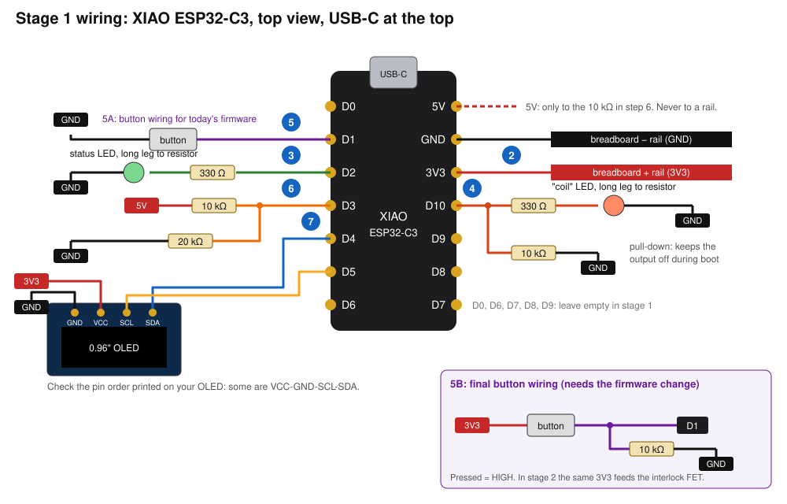

# Stage 1: breadboard build

Logic prototype: the XIAO on USB power, an LED standing in for the coil.
No battery, no MOSFETs, nothing that can get hot. Allow one evening.



## Before you start

**Parts:** 1 XIAO ESP32-C3 with its two 7-pin headers, breadboard, jumper
wires, 2 LEDs (ideally different colours), 2 × 330 Ω, 2 × 10 kΩ, 1 × 20 kΩ
(or two 10 kΩ in series), 1 tactile button, a USB-C **data** cable. The OLED
joins in step 7 when it arrives.

**The button switches 3V3, not ground.** Pressed = D1 high. The same 3V3
will drive the interlock FET in stage 2, so the breadboard uses the final
wiring from the start. (Firmware before 2026-11-13 expected the button to
ground; flash the current firmware.)

**Solder the battery wires first.** Stage 2 needs wires on the two BAT pads
on the *underside* of the XIAO, between the D2–D4 pins. They are far easier
to solder before the headers go on:

1. Hold the XIAO upside down with the USB socket away from you. The pads
   are marked BAT, with `−` nearer the USB end and `+` nearer the antenna end.
   Confirm with the multimeter on continuity: the `−` pad beeps to the GND pin.
2. Tin both pads. Solder 10 cm of thin wire to each (red to `+`, black to `−`;
   24–28 AWG is plenty, it only carries the XIAO's own current).
3. Lay both wires flat, leading out between the pin rows at the antenna end.
   Fix them with a dab of hot glue or Kapton tape so the pads don't take the strain.
4. Put a bit of tape over each bare wire end until stage 2.

Then solder the headers with the XIAO sitting in the breadboard to keep the
pins straight. Press the antenna plug on to the small round gold socket until it clicks; Wi-Fi is
not used yet, but it is fragile and easier to fit now.

## Breadboard position

Put the XIAO at one end of the breadboard, straddling the centre channel,
USB socket pointing off the end. Each pin then has its own breadboard row.
With USB at the top:

| Row | Left pin | Right pin |
|---|---|---|
| 1 | D0 | 5V |
| 2 | D1 | GND |
| 3 | D2 | 3V3 |
| 4 | D3 | D10 |
| 5 | D4 | D9 |
| 6 | D5 | D8 |
| 7 | D6 | D7 |

## Steps

Unplug USB before each wiring change. Plug in again for the test.

### 1. Flash and talk to it

Nothing wired yet. Plug in USB, then from the repo folder:

```bash
pio run -e xiao_esp32c3 -t upload
```

```bash
pio device monitor
```

**Test:** type `status` and press Enter. You should see a line starting
`Puff fw 0.1.0 stage 1`. If the upload can't find the board, hold the BOOT
button (marked B) while plugging in USB, then upload again.

### 2. Power rails

- XIAO GND (row 2, right) → breadboard `−` rail.
- XIAO 3V3 (row 3, right) → breadboard `+` rail.

**Test:** multimeter on DC volts across the rails reads 3.25–3.35 V.

Never connect the 5V pin to a rail. Anything above 3.3 V on a data pin can
damage the chip.

### 3. Status LED (D2)

D2 → 330 Ω → LED long leg; LED short leg → `−` rail.

**Test:** it does nothing until the button exists. To check the LED itself,
move the D2 end of the resistor to the `+` rail for a moment: the LED lights.
Move it back.

### 4. "Coil" LED and pull-down (D10)

- D10 → 330 Ω → second LED long leg; short leg → `−` rail.
- D10 → 10 kΩ → `−` rail.

The 10 kΩ does nothing visible here. In stage 2 it keeps the MOSFET off
while the XIAO boots, so it is worth having in place from the start.

**Test:** same trick as step 3: touch the resistor's D10 end to `+`, LED lights.

### 5. Fire button (D1)

- `+` rail (3V3) → button → D1.
- D1 → 10 kΩ → `−` rail.

A 4-leg tactile button has its legs joined in pairs. If the output is stuck
on, turn the button a quarter turn.

**Test first with the multimeter:** D1 to GND reads 0 V released and 3.3 V
pressed.

**Tests:**

| Do this | You should see |
|---|---|
| Hold the button | Coil LED on while held. Serial prints a `puff #…` line on release if held over 0.3 s |
| Click 3 times quickly | Status LED blinks the new preset number (1–5: 2.4, 2.7, 3.0, 3.3, 3.6 V; it starts on 3). The coil LED gets brighter with higher presets |
| Click 5 times | 3 short blinks = locked. Holding now gives 2 fast blinks and no output. 5 clicks again = 1 long blink, unlocked |
| Hold for 10 s | Output stops at 10 s, status LED blinks 4 times. Stays off until you release |
| Type `sim batt 3200` | Holding the button is refused (6 fast blinks). `sim batt 3500` restores it |
| Type `sim ohm 300`, then `sim ohm 9000` | Both refused (short, then no cartridge). `sim ohm 1500` restores it |
| Type `sim chg 1` | Refused (charging). `sim chg 0` restores it |
| Hold the button and type `sim ohm 9000` | Output stops mid-hold |
| Type `log` | One CSV row per puff. Unplug, replug, `log` again: the rows are still there |

### 6. USB-present sense (D3)

- 5V pin → 10 kΩ → D3.
- D3 → 20 kΩ → `−` rail.

**Test:** multimeter from D3 to GND reads 3.2–3.4 V with USB plugged in.
If it reads about 5 V, the 20 kΩ is not connected: unplug at once and fix it.
The firmware does not read this pin yet; in stage 2 it is how Puff knows
it is on the charger.

### 7. OLED (D4, D5), when it arrives

Read the four labels printed on the OLED board. The order varies between
sellers and getting VCC and GND swapped kills the display.

- OLED VCC → `+` rail (3V3)
- OLED GND → `−` rail
- OLED SDA → D4
- OLED SCL → D5

**Tests:**

- VCC to GND at the OLED reads 3.3 V and nothing gets warm.
- Unplug and replug USB (the display is only looked for at start-up). The
  screen shows battery at the top, the preset voltage in large digits, and
  the puff count at the bottom.
- Type `i2c`: it lists `0x3c (OLED)`. If it lists nothing, SDA and SCL are
  swapped or one is loose.
- Click 3 times: the large voltage changes. Click 5 times: it shows LOCKED.
- The screen does not change during a puff; it updates when you let go.

## Not in stage 1

- **D0:** reserved for the INA260's Alert in stage 2. Keep empty.
- **D7 resistance check:** stage 2.
- **D8, D9:** reserved for the two game buttons (each to GND). The firmware
  does not read them yet. D9 is the BOOT pin: if it is low when the board
  powers up, the bootloader starts instead of Puff.
- **D6:** keep empty.

## When it all works

Leave the breadboard assembled. Stage 2 connects the power board to it with
8 jumper wires; see [stage2-perfboard.md](stage2-perfboard.md).
