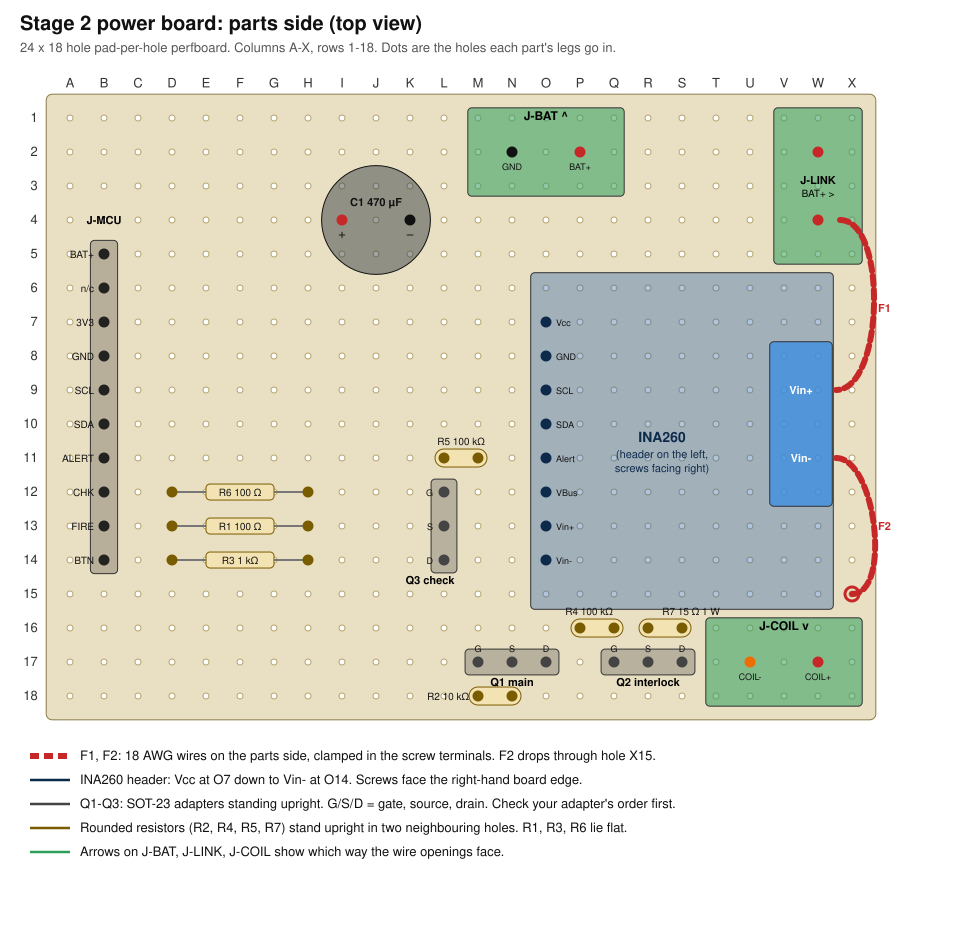
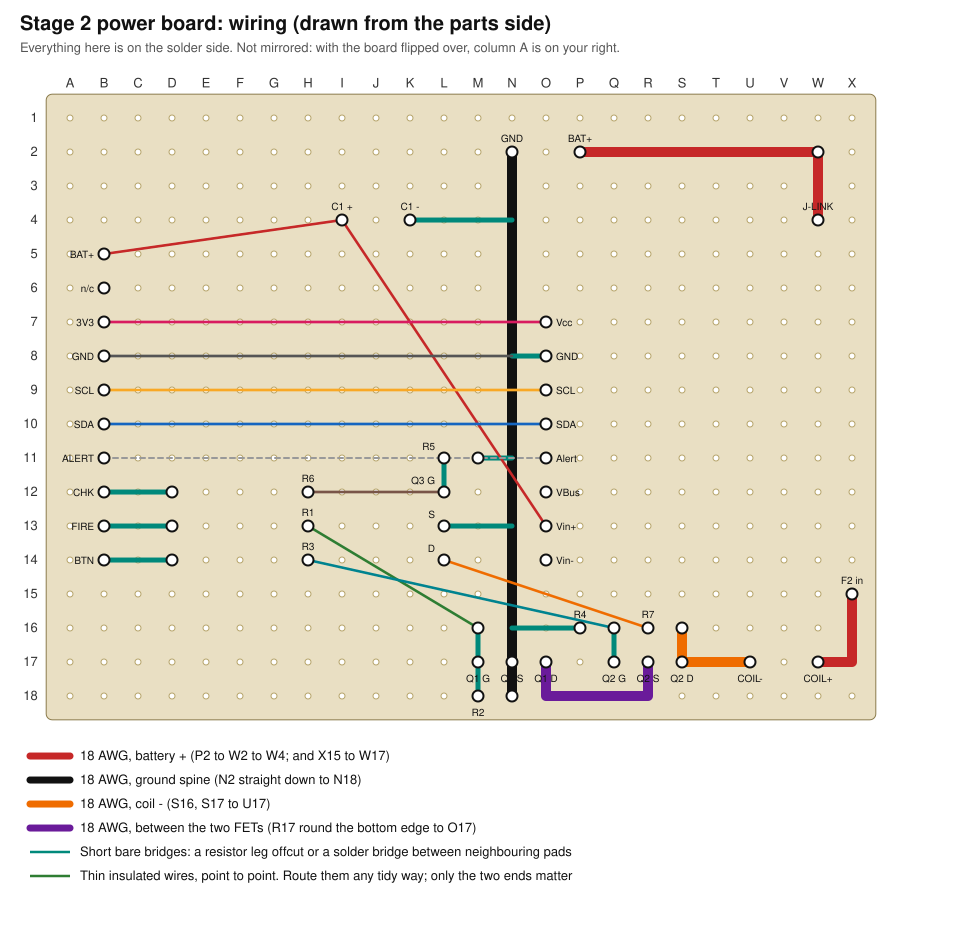

# Stage 2: power board layout

The soldered board that carries the coil current: battery in, INA260, two
MOSFETs in series, coil out. The XIAO, button, LEDs and OLED stay on the
stage 1 breadboard and connect through one header.

Build it, then follow [first-power-checklist.md](first-power-checklist.md)
before a cell goes anywhere near it.

## What you need to know first

- **Board:** drawn for a 5 × 7 cm pad-per-hole perfboard, 24 × 18 holes,
  copper pads underneath. If yours is strip-type or a different size, tell me
  and I'll redraw it. On a breadboard-pattern board the layout does not apply.
- **Coordinates:** columns A–X left to right, rows 1–18 top to bottom, looking
  at the parts side with the long edge horizontal. Write A, X, 1 and 18 on the
  board with a marker before you start.
- **Screw terminals:** drawn as 2-way, 5 mm pitch, so the two pins sit two
  holes apart. You need three.
- **System ground is the protection board's P−, not the cell's negative.**
  The cell's negative goes only to the protection board's B− pad. Everything
  else on this page that says GND means P−. If the cell's negative touches
  board GND directly, the protection board is bypassed.

## Battery pack

Make this as its own assembly, off the board. Nothing here is live until the
cell is inserted, so build it with the holder empty.

```
holder + pin ── 5 A fuse ── B+ ┐                ┌ P+ ── red 18 AWG ──► J-BAT "BAT+"
                               │ protection board│
holder − pin ───────────────── B− ┘                └ P− ── black 18 AWG ─► J-BAT "GND"
```

1. The Keystone 1043P holder has one solder pin at each end, 71.6 mm apart.
   It is shaped so the cell only makes contact the right way round; the `+`
   end is marked in the plastic.
2. Solder one leg of a 5 A fuse directly to the `+` pin. Solder a short
   18 AWG wire from the other leg to **B+** on the protection board. Cover the
   fuse and both joints in heat-shrink. The fuse sits right at the cell so
   that every wire after it is protected.
3. Solder 18 AWG from the holder's `−` pin to **B−**.
4. Solder a red 18 AWG lead (about 10 cm) to **P+** and a black one to **P−**.
5. Tape or heat-shrink the protection board so no bare metal shows, and tape
   it to the side of the holder.
6. Check with the multimeter on continuity, holder still empty: `+` pin to
   red lead beeps (through the fuse). `−` pin to black lead may or may not
   beep; both are normal with no cell. Red lead to black lead: no beep.

On most of these boards B+ and P+ are the same copper, and the switching is
done between B− and P−. That is why the `−` side must go through the board.

## Parts side



Fit low parts first, tall parts last. Solder each one before the next.

| Order | Part | Holes | Notes |
|---|---|---|---|
| 1 | R6 100 Ω | D12, H12 | Flat |
| 2 | R1 100 Ω | D13, H13 | Flat |
| 3 | R3 1 kΩ | D14, H14 | Flat |
| 4 | R2 10 kΩ | M18, N18 | Standing: one leg folded back down beside the body |
| 5 | R4 100 kΩ | P16, Q16 | Standing |
| 6 | R5 100 kΩ | L11, M11 | Standing |
| 7 | R7 15 Ω 1 W | R16, S16 | Standing, body 3 mm clear of the board. It gets hot if the check ever sticks on |
| 8 | J-MCU, 10-pin header | B5–B14 | Pins up, for jumper wires to the breadboard |
| 9 | Q3 (check) on its adapter | L12 G, L13 S, L14 D | See "MOSFET adapters" below |
| 10 | Q1 (main) on its adapter | M17 G, N17 S, O17 D | |
| 11 | Q2 (interlock) on its adapter | Q17 G, R17 S, S17 D | |
| 12 | INA260 | Header in O7–O14, Vcc at O7 | Solder its 8-pin header to the INA260 first, long pins down. Blue screw block faces the right-hand edge |
| 13 | J-BAT | N2 (GND), P2 (BAT+) | Openings face the top edge |
| 14 | J-LINK | W2, W4 | Openings face the right edge |
| 15 | J-COIL | U17 (COIL−), W17 (COIL+) | Openings face the bottom edge |
| 16 | C1 470 µF | I4 (+), K4 (−) | The stripe on the can marks `−`. Backwards, it can burst |

### MOSFET adapters

The AO3400A is a 3 mm part with pin 1 = gate, pin 2 = source on the two-pin
side, and pin 3 = drain alone on the other side.

1. Solder each FET to an adapter: tin one pad, slide the part on with
   tweezers, then solder the other two legs. Flux helps a lot.
2. Solder a 3-pin header to the adapter.
3. **Work out which header pin is which** before it goes on the board. Follow
   the adapter's traces, or use continuity from each FET leg to each pin.
   The layout assumes the pins come out in the order G, S, D. If yours come
   out differently, keep each pin's *connections* from the wiring table and
   move the wires, not the part.
4. Test each FET on its adapter. Multimeter on diode test, red probe on
   source, black on drain: about 0.4–0.7 V. Swap the probes: open circuit.
   Gate to either other pin: open circuit both ways.
5. On Q1 and Q2, flow extra solder along the adapter's source and drain
   traces. They are the thinnest conductor in the whole 3.5 A path.

## Wiring side



The drawing is seen from the parts side, as if the board were glass. When
you turn the board over to solder, left and right swap.

### High-current wires: 18 AWG, soldered along their whole end

These seven joints carry up to 3.5 A. Lay the stripped wire flat across the
pads it passes and solder it to each one. Make every joint shiny and fully
wetted; a dull or balled joint here will heat up.

| # | Net | Route | Length |
|---|---|---|---|
| H1 | Battery + | P2 → along row 2 → W2 → W4 | bare, 9 pads |
| H2 | Ground spine | N2 → straight down column N → N18 | bare, 17 pads |
| H3 | Coil − | S16 → S17 → T17 → U17 | bare, 4 pads |
| H4 | Between the FETs | R17 → R18 → Q18 → P18 → O18 → O17 | bare; keep it off Q17 and P17 |
| H5 | Coil + | X15 → X16 → X17 → W17 | the tail of F2, below |
| F1 | Battery + to sensor | J-LINK screw (W4) → INA260 **Vin+** screw | parts side, about 4 cm, insulated |
| F2 | Sensor to coil + | INA260 **Vin−** screw → down through hole X15 | parts side, about 4 cm, insulated |

If 18 AWG won't pass through hole X15, open it up with a 1.5 mm drill bit.

The spine H2 is one wire for a reason: Q1's source (N17), Q3's source, the
INA260 ground, C1 and the battery negative all meet on it.

### Short bridges: bare offcut or solder bridge

| From → to | Net |
|---|---|
| B12 → C12 → D12 | CHK into R6 |
| B13 → C13 → D13 | FIRE into R1 |
| B14 → C14 → D14 | BTN into R3 |
| K4 → L4 → M4 → N4 | C1 − to the spine |
| O8 → N8 | INA260 GND to the spine |
| L11 → L12 | R5 to Q3 gate |
| M11 → N11 | R5 to the spine |
| L13 → M13 → N13 | Q3 source to the spine |
| M16 → M17 → M18 | Q1 gate to R2 |
| N18 → N17 | R2 to the spine (already on H2) |
| Q16 → Q17 | R4 to Q2 gate |
| P16 → O16 → N16 | R4 to the spine |

### Thin insulated wires: point to point

Any thin hookup wire (24–28 AWG). Only the two ends matter.

| # | From | To | Signal |
|---|---|---|---|
| W1 | B5 | I4 | Battery + to the XIAO, and C1 + |
| W2 | I4 | O13 | C1 + to INA260 Vin+ pin |
| W3 | B7 | O7 | 3V3 to INA260 Vcc |
| W4 | B8 | N8 | Ground |
| W5 | B9 | O9 | SCL |
| W6 | B10 | O10 | SDA |
| W7 | H12 | L12 | CHK to Q3 gate |
| W8 | H13 | M16 | FIRE to Q1 gate |
| W9 | H14 | Q16 | BTN to Q2 gate |
| W10 | R16 | L14 | R7 to Q3 drain |
| (W11) | B11 | O11 | INA260 Alert, to D0. Optional, not used by the firmware yet. Never connect Alert to a FET gate |

Leave O12 (VBus) and O14 (Vin−) with nothing soldered but the pin itself.
The INA260 already links VBus to Vin+ on its own board, which is what we want:
it then reports the battery voltage as well as the current.

## What connects to what

For checking your work with the multimeter, by net:

| Net | Everything on it |
|---|---|
| BAT+IN | J-BAT P2, J-LINK W2 and W4 |
| VBATT | INA260 Vin+ (screw and pin O13), C1 +, J-MCU BAT+ |
| COIL+ | INA260 Vin− (screw and pin O14), J-COIL W17 |
| COIL− | J-COIL U17, Q2 drain, R7 (S16) |
| MID | Q2 source, Q1 drain |
| GND | J-BAT N2, Q1 source, Q3 source, R2, R4, R5, C1 −, INA260 GND, J-MCU GND |
| Q1 gate | R1 → FIRE, R2 → GND |
| Q2 gate | R3 → BTN, R4 → GND |
| Q3 gate | R6 → CHK, R5 → GND |
| CHK path | R7 (R16) → Q3 drain |

BAT+IN and VBATT are deliberately separate nets. They are joined only by
wire F1 between the two screw terminals, so that for the first power-up a
15 Ω resistor can take F1's place and limit any fault to a quarter of an amp.

## Connecting to the breadboard

Eight jumper wires from J-MCU, plus one change on the breadboard.

| J-MCU pin | Goes to | Notes |
|---|---|---|
| B5 BAT+ | The red wire from the XIAO's BAT+ pad | Join in a spare breadboard row |
| B7 3V3 | `+` rail | |
| B8 GND | `−` rail | The XIAO's black BAT− wire also goes to the `−` rail |
| B9 SCL | D5 | Shared with the OLED |
| B10 SDA | D4 | Shared with the OLED |
| B12 CHK | D7 | |
| B13 FIRE | D10 | Remove the stage 1 "coil" LED and its 330 Ω. Keep the 10 kΩ pull-down |
| B14 BTN | The D1 side of the button | The button now feeds D1 and Q2's gate together |

There is no battery divider: the INA260 reads battery voltage more
accurately than the XIAO's ADC. D0 is reserved for the INA260's Alert
(B11, optional, see the pin table in `hardware.md`). Leave B11 unconnected
until the firmware uses it.

## Dummy load

Bolt the HS25 to the aluminium plate with two M3 screws. Solder 18 AWG leads
(about 15 cm) to its two lugs and heat-shrink them. Either lead goes in
either J-COIL screw; a resistor has no polarity. Do not connect it until the
checklist says so.

The HS25 is wire-wound, so it kicks back a little each time the FET switches
off. If you have a Schottky diode (1N5819, 1N5822, SS34 or similar), clamp
it in J-COIL alongside the load leads, stripe towards COIL+. It is not
needed for a real cartridge.
